# DumTech Hub

Plataforma de aplicativos para Windows. O **Hub** e o programa central instalado no
computador do cliente; os **aplicativos DumTech** aparecem dentro dele conforme a
licenca liberar. Tudo funciona **sem internet**: os dados ficam em bancos SQLite na
pasta do usuario.

```
DumTech Hub
├── DumTech Estoque            produtos, entradas e saidas
├── DumTech Clientes           cadastro compartilhado com os outros aplicativos
├── DumTech Financeiro         fluxo de caixa, parcelamento e projecao de 30 dias
├── DumTech Orcamentos         proposta comercial, funil e taxa de conversao
├── DumTech Vendas             PDV de balcao, pagamento e caixa do dia
├── DumTech Ordem de Servico   quadro por etapa, aprovacao e garantia
└── DumTech Agenda             grade da semana, conflito de horario e bloqueio
```

**Tudo em uma janela so.** O trilho da esquerda e a navegacao da plataforma:
Inicio, os aplicativos liberados (com um ponto na cor de quem esta aberto),
licenca e tema. Abrir um aplicativo nao cria janela nova no Windows - ele e
montado ali mesmo, com uma barra de contexto na cor dele e as telas em abas.

`Ctrl+K` abre a paleta de comandos: digite parte do nome para abrir um
aplicativo, pular direto para uma tela dele ("Vendas > Painel") ou trocar o
tema. `Ctrl+W` fecha o aplicativo atual.

O Inicio abre com **Hoje**: o que precisa de atencao agora, somando o que cada
aplicativo ja sabia sozinho - conta vencida, ordem atrasada, proposta sem
resposta, estoque no minimo, compromisso do dia, aniversariante. Cada linha
abre o aplicativo que resolve aquilo, e cada aviso pode ser desligado ou ter o
prazo ajustado em Configuracoes.

| Central de aplicativos | Tema claro |
|---|---|
| 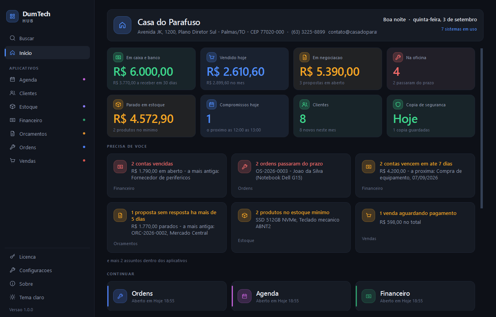 | 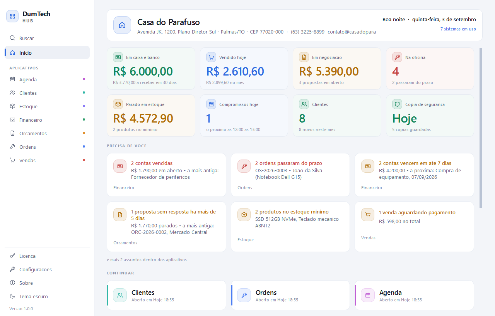 |

| Agenda | Dados da empresa |
|---|---|
| 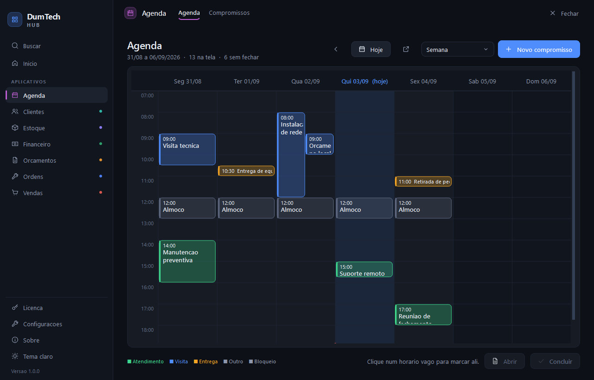 | 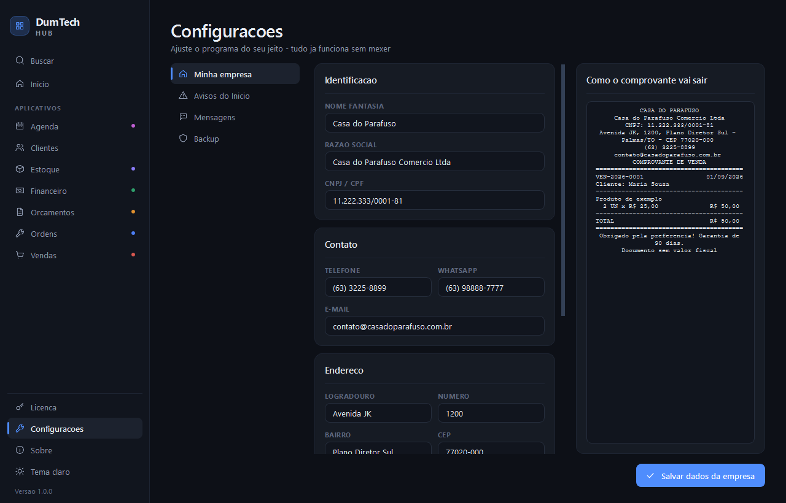 |

Os documentos saem com a identidade da loja - e a proposta e o comprovante de
entrega saem tambem em folha A4, prontos para virar PDF e ir por e-mail.

Os modulos conversam quando estao juntos, e funcionam sozinhos quando nao
estao: a venda a prazo vira conta a receber no Financeiro (e a conta se fecha
sozinha quando o cliente volta e paga), a ordem entregue vira conta com um
clique, e a proposta aprovada vira venda ou ordem de servico com os itens ja
dentro. Sem o outro modulo na licenca, o botao nao aparece e nada quebra.

E conversam **na hora**. Quando um modulo escreve no dado de outro, o outro
fica sabendo: a venda da baixa e o Estoque aberto ao lado ja mostra o saldo
novo, a ordem entregue aparece no Financeiro, o cliente cadastrado agora ja
vem na sugestao do balcao. Ninguem precisa fechar e abrir o modulo para ver o
que acabou de acontecer. Quem esta na frente recarrega na hora; quem esta
atras recarrega ao voltar, para nao gastar leitura de banco a toa.

| Proposta comercial | Comprovante de entrega |
|---|---|
| 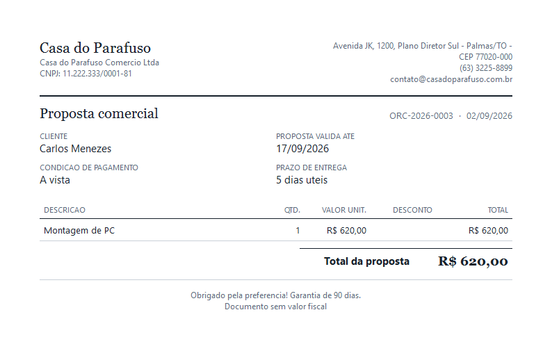 | 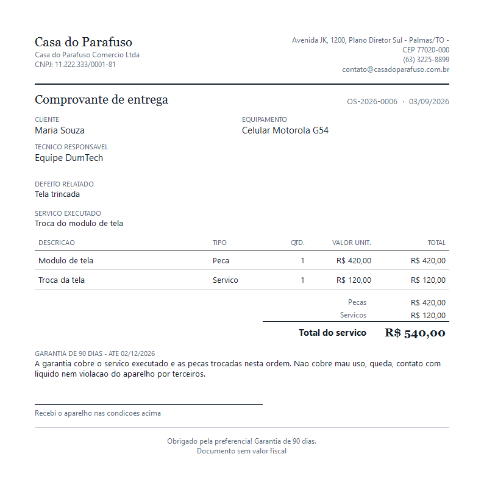 |

Cada modulo tem um botao de WhatsApp que abre a conversa com o texto pronto -
proposta enviada, servico pronto, lembrete de vencimento, agradecimento de
venda, confirmacao de horario e aniversario. Os seis textos ja vem escritos e
sao editaveis em Configuracoes, com previa ao vivo.

| Mensagens de WhatsApp | Backup |
|---|---|
| 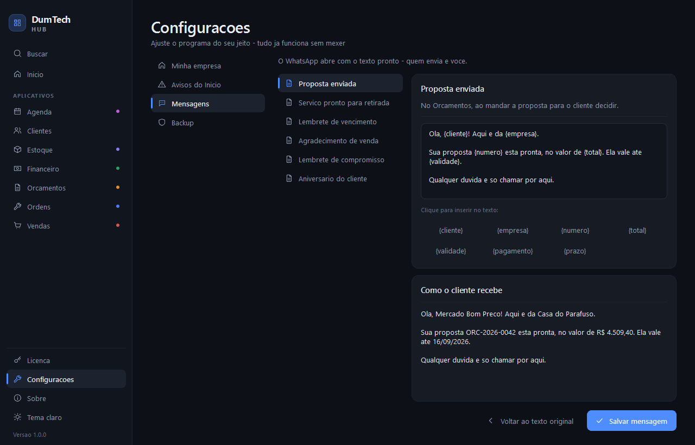 | 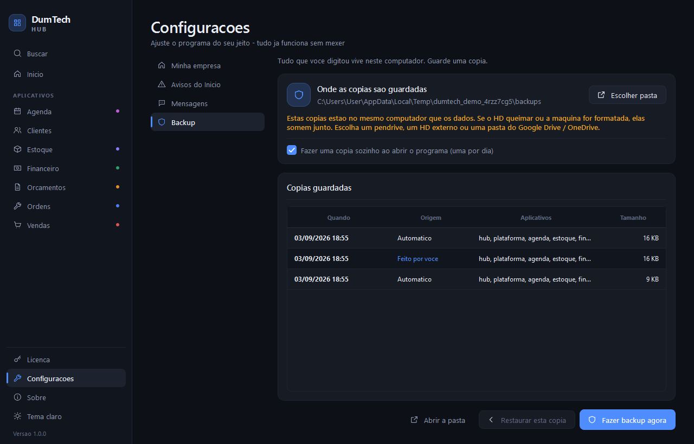 |

| Estoque | Financeiro |
|---|---|
| 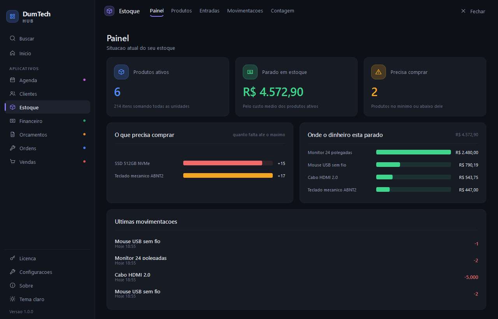 | 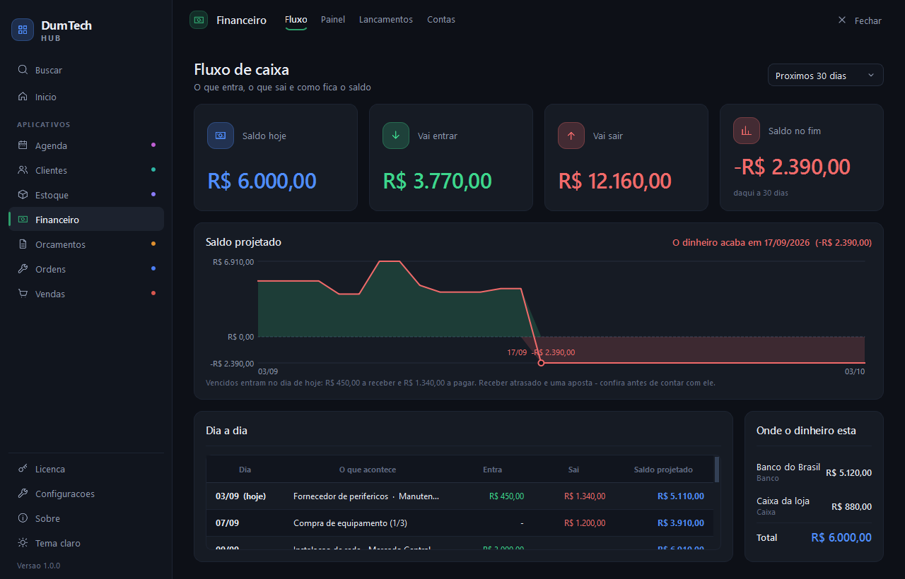 |

| Vendas | Ordem de Servico |
|---|---|
| 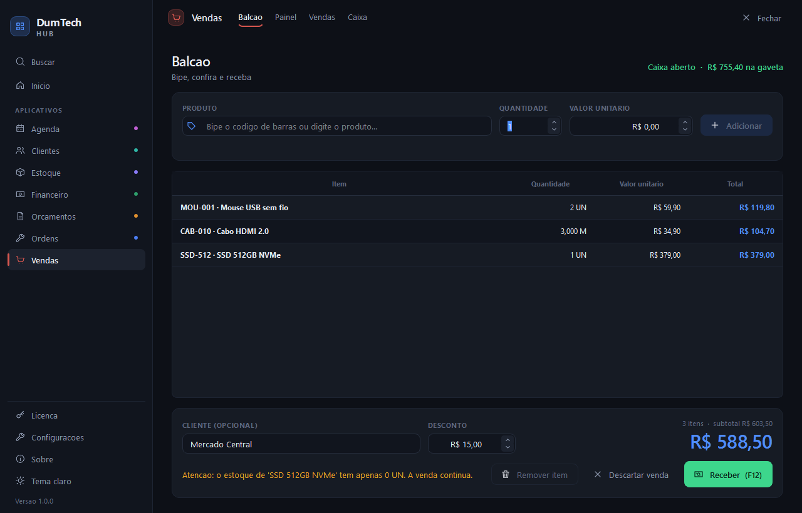 | 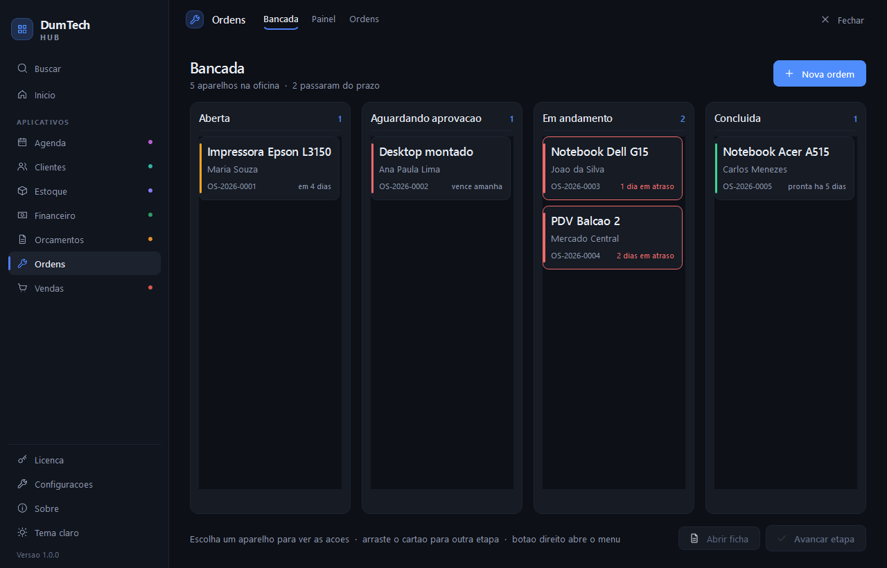 |

---

## Os aplicativos

| Aplicativo | O que faz | Telas |
|---|---|---|
| **Estoque** | produtos com codigo de barras, unidade (UN/KG/M...), local na prateleira, minimo e maximo; entrada de nota inteira com custo medio; baixa rapida pelo leitor; contagem (balanco); importar/exportar CSV; **produtos para reposicao** (zerado antes de baixo) com a quantidade sugerida para o estoque maximo | Painel, Produtos, Entradas, Movimentacoes, Contagem |
| **Clientes** | cadastro de clientes (documento, telefone, e-mail, cidade). E a agenda que os outros aplicativos usam para sugerir nomes; **parceiros** que indicam clientes, com quantos clientes cada um ja indicou | Painel, Clientes, Parceiros |
| **Financeiro** | fluxo de caixa com projecao de 30 dias e o dia em que o dinheiro acaba; parcelamento (1.200 em 3x vira tres contas) e despesa que se repete todo mes; recebimento parcial; contas (caixa, banco, cartao) com transferencia entre elas | Fluxo de caixa, Visao geral, Lancamentos, Contas bancarias |
| **Orcamentos** | proposta com condicao de pagamento, prazo de entrega e desconto por item; documento pronto para imprimir; duplicar uma proposta antiga; funil com taxa de conversao, o que esta parado esperando resposta e **por que voce perde** (achou caro, prazo, comprou de outro) | Funil, Orcamentos |
| **Vendas** | PDV de balcao com leitor de codigo de barras; pagamento em varias formas na mesma venda, com troco; cancelamento com motivo e devolucao (total ou parcial); comprovante impresso; caixa do dia com sangria, suprimento e conferencia da gaveta | Balcao, Painel, Vendas, Caixa |
| **Ordem de Servico** | serve a qualquer ramo que emita ordem de servico, nao so assistencia tecnica: a ficha pede quem pediu, o que foi pedido, para quando e quanto, e o resto (o que veio junto, estado na chegada, senha) abre so para quem precisa. Quadro com as ordens por etapa; material e mao de obra separados; aprovacao do orcamento com data e quem autorizou; historico de cada passo com hora; garantia contada da entrega; comprovantes de entrada e de entrega impressos | Quadro, Painel, Ordens |
| **Agenda** | grade da semana (ou do dia) com o tempo desenhado: bloco na altura da duracao, cor por tipo e a linha da hora atual; clique num horario vago marca ali; aviso de conflito antes de salvar; bloqueio para almoco, folga e feriado; repeticao diaria, semanal, quinzenal ou mensal; **link de agendamento online**: o cliente escolhe servico, dia e horario livre pelo celular e o compromisso cai na Agenda sozinho (e ele cancela pelo proprio link) | Agenda, Compromissos, Online |

Cada aplicativo tem **seu proprio banco de dados** e funciona sozinho: quem comprar
so um deles nao perde nada.

### Backup

Todo dado do cliente vive em `%APPDATA%\DumTech Hub\data`. A tela **Backup** do
Hub grava um `.zip` unico com todos os bancos - da para levar no pendrive, no HD
externo ou numa pasta do Google Drive. Uma copia e feita sozinha ao abrir o
programa (uma por dia, guardando as 10 ultimas); as copias feitas a mao nunca
sao apagadas.

A copia usa a API de backup do SQLite, e nao um `copiar e colar` do arquivo: os
bancos ficam em modo WAL, e uma copia crua sairia pela metade. Restaurar fecha
tudo antes de trocar os arquivos e guarda uma copia do estado atual antes, para
o caso de a copia escolhida ser a errada.

A tela avisa quando as copias estao no mesmo computador que os dados - porque
copia no mesmo HD nao salva de HD queimado.

### Quando alguma coisa da errado

Erro inesperado nao some: ele vai inteiro para `logs\dumtech.log` (arquivo
rotativo, ate 2 MB x 4) e aparece numa caixa que diz o que aconteceu, com o
relatorio pronto para copiar e mandar ao suporte - data, versao, sistema e a
pilha completa. O programa **continua aberto**: um erro numa tela nao faz o
cliente perder o que estava fazendo em outra.

Sem isso, o traceback iria para o stderr - que no executavel (montado sem
console) simplesmente nao existe.

**Quem tem os dois ganha a ponte.** Com o Estoque liberado na licenca, o Balcao
do Vendas bipa o produto direto do catalogo, traz preco e saldo, e a venda da
baixa no estoque (o cancelamento e a devolucao devolvem). Sem o Estoque, o item
do balcao e digitado na hora - a venda funciona igual.

### Estoque no balcao

O leitor de codigo de barras USB se comporta como teclado: ele digita o codigo e
da Enter. Por isso as telas de Produtos, Entradas e Contagem tem um campo de
bipe no topo - bipou, o produto e encontrado e a acao ja abre preenchida. Sem
leitor, digitar o codigo (ou parte do nome) e teclar Enter faz o mesmo.

Na lista de produtos, **E** da entrada e **S** da saida no item selecionado, sem
trocar de tela. **Ctrl+B** volta o foco para o campo de bipe.

O **custo medio** se atualiza sozinho: toda entrada com custo informado recalcula
a media ponderada, entao "quanto tenho parado em estoque" nao envelhece.

Produto com historico nao e excluido, e **inativado** - some das listas e o
historico continua inteiro.

## Licenca (Supabase)

O Hub mostra **somente os aplicativos que aquela licenca liberou**. A internet e
usada apenas para **ativar** a chave e para **verificar** (quando o cliente compra
outro aplicativo); no dia a dia tudo roda offline com os dados locais.

| Sem licenca | Com licenca |
|---|---|
| 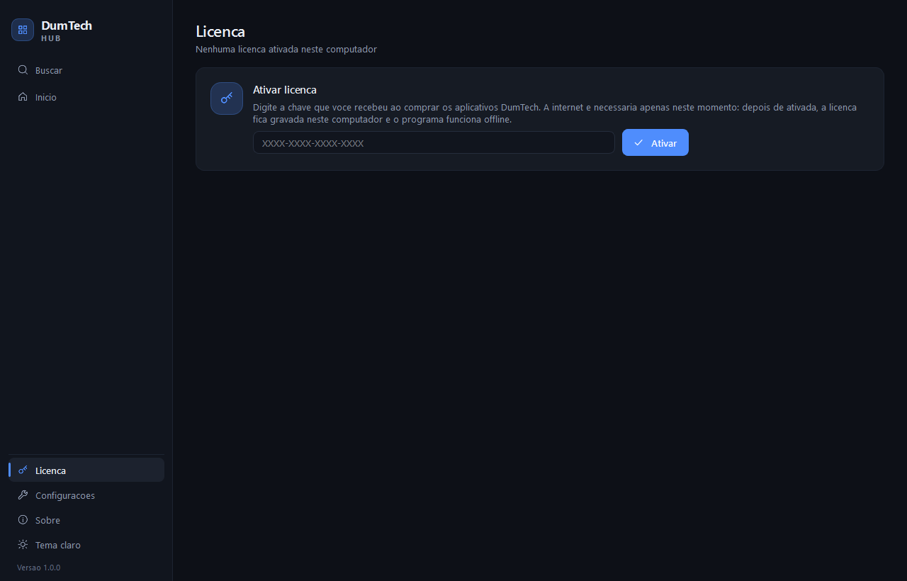 | 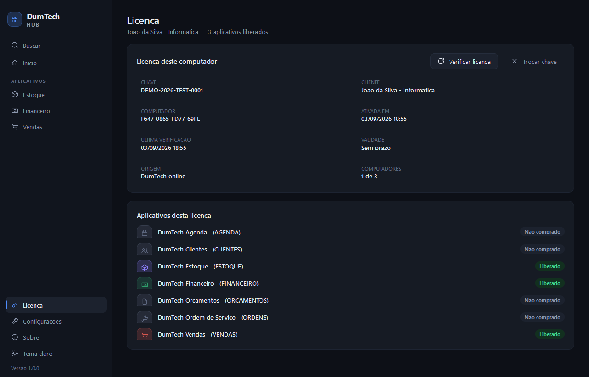 |

O banco guarda **clientes -> licencas -> produtos** (e combos, que sao pacotes de
produtos): cada modulo DumTech e um registro de `produtos`, e uma unica chave
libera tudo o que o cliente comprou.

Na primeira vez, o Hub se apresenta: pede **nome e e-mail** (os mesmos que
assinam os comprovantes), depois a chave - com a saida "ainda nao tenho chave"
para quem so quer conhecer. Dai em diante o Inicio mostra os modulos liberados,
as **ofertas** da DumTech e o botao **Adquirir novo produto**, que abre a loja
no navegador ja identificando o cliente.

Para ligar (uma vez so): `supabase link --project-ref <ref>` e `supabase db push`
(as migrations estao em [supabase/migrations/](supabase/migrations/)). Confira com:

```powershell
.venv\Scripts\python.exe toolserificar_licenciamento.py
```

O passo a passo completo (emitir chaves, suspender, trocar de computador) esta em
[docs/licenciamento.md](docs/licenciamento.md).

Durante o desenvolvimento, `DUMTECH_LICENCA_LOCAL=1` libera tudo sem consultar a
internet.

## Temas claro e escuro

O **Hub** tem um botao de tema no rodape do trilho: ele muda a plataforma inteira
- inclusive os aplicativos abertos - e a escolha fica gravada para as proximas
vezes. Como tudo roda numa janela so, nao faz mais sentido um aplicativo ficar
claro dentro de um Hub escuro: quem manda no tema e o Hub.

A preferencia de tema por aplicativo continua existindo no codigo e vale quando
uma casca e aberta fora do Hub (testes e execucao avulsa).

As preferencias ficam em `%APPDATA%\DumTech Hub\config\hub.json`.

---

## Tecnologia

| Item | Escolha | Por que |
|------|---------|---------|
| Linguagem | Python 3.11+ | evolucao rapida do projeto |
| Interface | **PySide6 (Qt 6)** | visual moderno e profissional, estilo proprio (QSS), varias janelas, roda nativo no Windows, licenca LGPL (uso comercial liberado) e empacota bem com PyInstaller |
| Banco local | SQLite (modulo padrao do Python) | um arquivo por aplicativo, sem servidor, funciona offline |
| Empacotamento | PyInstaller | gera .exe; o cliente nao precisa instalar Python |

## Rodando em desenvolvimento

```powershell
python -m venv .venv
.venv\Scripts\python.exe -m pip install -r requirements.txt
.venv\Scripts\python.exe run_hub.py
```

## Testes

```powershell
.venv\Scripts\python.exe -m unittest discover -v
```

Os testes usam uma pasta temporaria: nunca tocam nos dados reais.

## Gerando o executavel para Windows

```powershell
powershell -ExecutionPolicy Bypass -File build\build.ps1
```

Resultado: `build\dist\DumTech Hub\DumTech Hub.exe`.

---

## Estrutura do projeto

```
src/dumtech/
├── main.py              ponto de entrada do Hub
├── core/                base da plataforma (nao conhece nenhum aplicativo)
│   ├── paths.py         onde ficam os dados no computador
│   ├── database.py      SQLite + migracoes de esquema
│   ├── config.py        preferencias do Hub e de cada aplicativo
│   ├── contacts.py      agenda de clientes compartilhada
│   ├── supabase.py      cliente HTTP do servidor de licencas
│   ├── app_module.py    CONTRATO que todo aplicativo cumpre
│   ├── registry.py      catalogo de aplicativos + regra de licenca
│   ├── licensing.py     licenca: ativacao no Supabase + uso offline
│   └── hub_store.py     banco do proprio Hub (uso dos aplicativos)
├── ui/                  identidade visual compartilhada
│   ├── theme.py         SISTEMA VISUAL: paletas, escalas de tipo/espaco, QSS
│   ├── app_shell.py     AppSurface: a casca que cada aplicativo preenche
│   ├── icons.py         icones em SVG gerados no proprio codigo
│   ├── format.py        dinheiro, numeros e datas em portugues
│   ├── tasks.py         chamadas demoradas fora da interface
│   └── widgets/         trilho, cartoes, paleta de comandos, tabelas, CRUD
├── hub/                 a central de aplicativos
│   ├── main_window.py   a janela unica: trilho + area de trabalho
│   ├── workspace.py     hospeda os aplicativos (barra de contexto + telas)
│   ├── launcher.py      cria e descarrega as cascas dos aplicativos
│   └── views/           Inicio, Licenca, Sobre
└── apps/                UM PACOTE POR APLICATIVO
    ├── __init__.py      lista dos aplicativos instalados
    ├── estoque/         module.py + models + repository + ui/
    ├── clientes/
    ├── financeiro/
    ├── orcamentos/
    ├── vendas/
    ├── ordens/
    └── agenda/
```

Cada aplicativo segue sempre o mesmo desenho:

```
<app>/
├── module.py      MANIFEST + create_window   <- o unico arquivo que o Hub enxerga
├── models.py      estruturas de dados
├── database.py    tabelas do <app>.db
├── repository.py  TODAS as regras (testaveis sem abrir janela)
└── ui/            window.py (casca) + telas
```

A casca de um aplicativo so precisa de tres coisas: `setup_data()` para abrir o
banco, `build_views()` para criar as telas com `add_view(titulo, icone, widget)`
e `teardown()` para fechar. Marca, navegacao, tema e o botao de fechar sao do
Hub - nenhum aplicativo desenha isso.

## Onde ficam os dados do cliente

```
%APPDATA%\DumTech Hub\
├── config\hub.json        preferencias (tema do Hub e de cada aplicativo)
├── config\license.json    licenca ativada (aplicativos liberados, para uso offline)
├── data\hub.db            uso dos aplicativos
├── data\plataforma.db     agenda de clientes compartilhada
├── data\apps\estoque.db   um banco por aplicativo
├── data\apps\vendas.db
└── logs\dumtech.log       registro de erros
```

Nada e gravado ao lado do programa, entao a instalacao pode ficar em
"Arquivos de Programas" sem problema, e os dados sobrevivem a atualizacoes.

## Documentacao

- [docs/arquitetura.md](docs/arquitetura.md) - como a plataforma funciona e
  **como adicionar um novo aplicativo** (passo a passo).
- [docs/licenciamento.md](docs/licenciamento.md) - o sistema de licencas com
  Supabase: como ligar, emitir chaves e o que o cliente ve.
- [supabase/migrations/](supabase/migrations/) - o esquema do servidor de
  licencas, em ordem. E daqui que o banco e construido (`supabase db push`).
- [docs/supabase/](docs/supabase/) - dois scripts avulsos de operacao: criar uma
  licenca de demonstracao e as consultas administrativas do dia a dia.
- [painel/README.md](painel/README.md) - o painel administrativo na web:
  clientes, licencas, pedidos, catalogo, anuncios e uso dos modulos.
- [landingpage/README.md](landingpage/README.md) - o site de vendas com
  "monte seu kit", publicado em https://dumtechsolution.com (HostGator). O Hub
  ainda traz uma copia, que ele serve em 127.0.0.1 quando esta sem internet.
