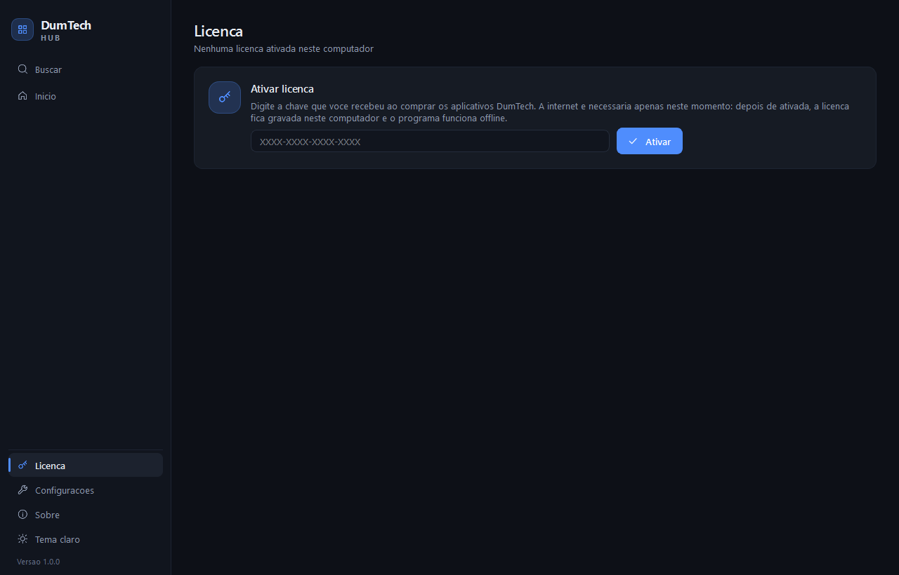
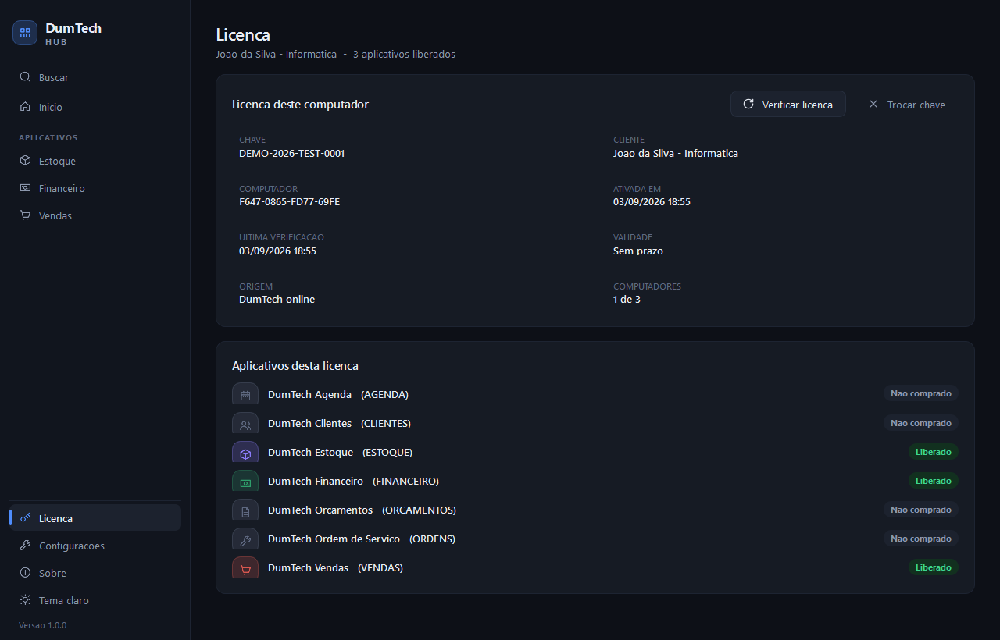

# Sistema de licencas (implementado)

A licenca diz **quais produtos aquele cliente comprou**. O Hub mostra somente
esses modulos e so eles abrem. A internet e usada **apenas** para ativar e para
verificar a licenca: no dia a dia tudo funciona offline.

```
CLIENTES ──< LICENCAS ──< LICENCA_PRODUTOS >── PRODUTOS
                 │                                 │
                 └──< ATIVACOES            COMBO_PRODUTOS >── COMBOS
```

Um cliente, uma chave, N produtos. Combo comprado entra expandido em produtos,
entao **o cliente nunca digita mais de uma chave**.

## O fluxo, do inicio ao fim

```
1. Cliente compra (ex.: o combo DumTech Gestao)
2. Voce emite a chave no Supabase        -> XXXX-XXXX-XXXX-XXXX
3. Cliente instala o DumTech Hub
4. Hub abre sem nenhum modulo e mostra "Ativar licenca"
5. Cliente digita a chave e clica em Ativar    <- UNICO momento com internet
      o Supabase confere: existe? esta ativa? no prazo? tem vaga de computador?
6. Supabase devolve ["CLIENTES", "ESTOQUE", "FINANCEIRO", "VENDAS"]
7. Hub grava config/license.json (ASSINADO pela DumTech) e libera os quatro modulos
8. A partir daqui o programa funciona OFFLINE; com internet, confere sozinho de hora em hora
9. Cliente compra o Ordens depois
      -> voce libera no painel (ou aprova o pedido do site)
      -> em ate 1 hora o modulo aparece sozinho (ou na hora, com "Verificar licenca")
10. Voce suspende ou cancela no painel
      -> em ate 1 hora os modulos param de abrir naquele computador
```

## Licenca assinada (o license.json nao se deixa editar nem copiar)

A conferencia passa pela Edge Function `licenca-assinada`, que devolve a licenca
assinada com uma chave Ed25519 que so existe no servidor. O Hub guarda o pacote e,
toda vez que carrega o arquivo, confere (`core/assinatura.py`, Python puro):

| Alguem tenta | O que acontece |
|---|---|
| acrescentar modulo no `license.json` | vale o que esta nos DOIS (arquivo e assinatura): nao libera |
| mudar o prazo no arquivo | vale o prazo assinado |
| mexer no conteudo assinado | a assinatura nao bate: licenca ignorada |
| copiar o arquivo para outro computador | assinado para outro MachineGuid: ignorado (ativar la gasta uma vaga, como deve) |
| ficar offline para sempre | passado `valida_ate` (30 dias), os modulos param ate conferir com internet |

Limite honesto: programa alterado para pular a conferencia, ou relogio atrasado para
esticar os 30 dias, exigem mexer no executavel. Enquanto `ASSINATURA_OBRIGATORIA`
estiver `False`, licenca SEM assinatura ainda abre (Hubs antigos); o passo a passo
para ligar esta em `supabase/functions/README.md`.

| Sem licenca | Com licenca |
|---|---|
|  |  |

## As tabelas

| Tabela | Para que serve |
|---|---|
| `clientes` | quem comprou, e tambem quem so instalou (`origem` = `venda` ou `hub`) |
| `produtos` | **catalogo comercial**: ESTOQUE, CLIENTES, FINANCEIRO, ORCAMENTOS, VENDAS, ORDENS, AGENDA... com preco, versao e `ativo` |
| `combos` + `combo_produtos` | pacotes (ex.: DumTech Gestao). Nao duplicam produto: apontam para ele |
| `licencas` | a chave, o `tipo` (vitalicia/assinatura/teste), o `status`, a validade e quantos computadores pode usar |
| `licenca_produtos` | **o que cada licenca libera** (com `combo_id` quando veio de um pacote) |
| `ativacoes` | em quais computadores a chave foi ativada, e a ultima checagem |
| `licenca_tentativas` | registro de tentativas recusadas (ajuda no suporte) |
| `comunicados` | ofertas e recados que o Hub mostra no Inicio |
| `compra_tokens` | o codigo curto que a loja troca por nome, e-mail e produtos |
| `licencas_resumo` | visao de apoio: cliente, produtos, situacao e computadores numa linha so |

Decisoes que valem lembrar:

- **Lancar um modulo novo e um INSERT em `produtos`**, nunca uma tabela nova.
- **`expirada` nao e um status gravado**: e calculada a partir de `expira_em`
  (`dumtech_situacao_licenca`), para o estado nao viver em dois lugares.
- **`tipo` e `expira_em` andam juntos** por regra do banco: vitalicia sem prazo,
  assinatura e teste com prazo.
- **Comprar um combo tira uma fotografia**: os produtos entram na licenca um a
  um. Mudar a composicao do combo amanha nao tira nem da modulo a quem ja
  comprou - o que vale e o que foi vendido.
- **`produtos.ativo = false` significa "saiu de linha"**: nao entra em venda
  nova, mas **quem ja comprou continua com o modulo**.

## As tres funcoes que o programa chama

| Funcao | Quando | O que faz |
|---|---|---|
| `dumtech_ativar_licenca(chave, maquina, apelido)` | botao **Ativar** | valida a chave, ocupa uma vaga de computador e devolve os produtos |
| `dumtech_verificar_licenca(chave, maquina)` | botao **Verificar licenca** | reconsulta sem ocupar vaga nova (o computador ja precisa estar ativado) |
| `dumtech_desativar_licenca(chave, maquina)` | botao **Trocar chave** | libera a vaga daquele computador |

Todas devolvem JSON no mesmo formato:

```json
{"ok": true,  "chave": "...", "cliente": "...", "tipo": "vitalicia",
 "produtos": ["ESTOQUE"], "aplicativos": ["ESTOQUE"],
 "expira_em": null, "max_computadores": 1, "computadores_usados": 1}

{"ok": false, "erro": "nao_encontrada", "mensagem": "Chave nao encontrada..."}
```

`aplicativos` e o nome antigo de `produtos` e continua na resposta para os
`.exe` instalados antes desta mudanca. O Hub novo le `produtos` e cai no campo
antigo se ele nao vier.

## A porta de entrada do cliente

Desde 11/09/2026 o Hub nao abre mais direto no Inicio quando e a primeira vez:
ele se apresenta.

```
1. "Quem e voce"  -> nome e e-mail
      vao para a secao `empresa` do hub.json (a mesma que assina os
      comprovantes: ninguem digita duas vezes a mesma coisa)
      e, em segundo plano, para o servidor (dumtech_identificar_cliente)
2. "Sua chave"    -> ativa a licenca, ou "ainda nao tenho chave"
3. Inicio         -> modulos liberados, ofertas e "Adquirir novo produto"
```

Nenhum passo espera a internet: sem rede o cadastro fica **pendente** e o Hub
reenvia sozinho na proxima abertura. Quem ja tem licenca nunca ve essa tela.

| Funcao | Quem chama | O que devolve |
|---|---|---|
| `dumtech_identificar_cliente(nome, email)` | Hub, no primeiro acesso | `{"ok": true}` - **nada mais** |
| `dumtech_comunicados(chave)` | Hub, 1x por dia | as ofertas de hoje, ja sem as do que ele tem |
| `dumtech_token_compra(chave, maquina, nome, email)` | Hub, no botao Adquirir | um codigo de 15 minutos |
| `dumtech_abrir_compra(token)` | **a landing page** | nome, e-mail e produtos liberados; queima o codigo |

**A regra de seguranca que desenha essas funcoes:** nenhuma delas devolve dado
de cliente que o proprio chamador ja nao tenha informado.

- `identificar_cliente` responde **igual** para e-mail novo e para e-mail que ja
  existe. Se respondesse diferente (ou devolvesse o id do cliente), viraria uma
  maquina de descobrir quem compra da DumTech.
- o token so carrega produtos de verdade quando a prova e a **chave de licenca
  com o computador ativado**. Quem se identifica so pelo e-mail recebe um token
  com o que ele mesmo digitou e `produtos: []` - mesmo que aquele e-mail seja de
  um cliente real.
- o token e de **uso unico**, vale 15 minutos e guarda uma fotografia: a troca
  nunca volta ao cadastro.

No Hub, isso vive em `core/conta.py` (o cadastro), `core/comunicados.py` (as
ofertas, com copia em `config/comunicados.json`), `core/loja.py` (o link) e
`hub/views/boas_vindas_view.py` (a tela).

**Enquanto nao existe dominio, a loja mora dentro do programa.** A pasta
`landingpage/` viaja no executavel e, no primeiro clique em "Adquirir novo
produto", o Hub a serve em `http://127.0.0.1:<porta livre>` e abre o navegador
ali (`core/loja.py::endereco_local`). Abrir o `index.html` por `file://` **nao**
funciona: o navegador recusa modulos ES vindos de arquivo e a pagina abre em
branco.

Quando o site entrar no ar, preencha `core/loja.py::URL_PADRAO` (ou defina
`DUMTECH_URL_LOJA`, que vence sobre tudo): o servidor local deixa de ser usado
sozinho, sem mais nenhuma mudanca.

### O que a landing page precisa fazer

```js
// ...comprar?t=CODIGO
const r = await fetch(`${SUPABASE_URL}/rest/v1/rpc/dumtech_abrir_compra`, {
  method: "POST",
  headers: { apikey: ANON, Authorization: `Bearer ${ANON}`,
             "Content-Type": "application/json" },
  body: JSON.stringify({ p_token: new URLSearchParams(location.search).get("t") }),
});
const dados = await r.json();   // {ok, nome, email, produtos:[...]}
```

Sem `t` (ou com codigo vencido), a pagina recebe `ok: false` e se comporta como
uma visita normal: `?origem=hub&tem=estoque,vendas` ainda diz o que nao adianta
oferecer.

## As funcoes da administracao

Rodam com o papel de quem chama (nunca `SECURITY DEFINER`) e so o `service_role`
tem permissao - a chave anon do aplicativo nao alcanca nenhuma delas.

| Funcao | O que faz |
|---|---|
| `dumtech_emitir_licenca(cliente, produtos[], combo, tipo, expira_em, max, obs, chave)` | gera a chave, cria a licenca e libera o que foi comprado |
| `dumtech_liberar_produtos(licenca_id, produtos[], combo)` | libera produtos ou um combo inteiro numa licenca que ja existe |
| `dumtech_nova_chave()` | sorteia uma chave XXXX-XXXX-XXXX-XXXX |
| `dumtech_aprovar_pedido(pedido_id, ...)` | transforma um kit montado no site em produto liberado, e devolve a chave |

O dia a dia inteiro (vender, criar combo, suspender, trocar computador, ver
tentativas) esta em [supabase/operacoes_admin.sql](supabase/operacoes_admin.sql),
pronto para colar no SQL Editor.

### O ciclo da compra pelo site

```
Hub, botao "Adquirir novo produto"
   -> landing page com ?t=<codigo>  (ja sabe quem e: nome, e-mail, o que tem)
   -> a pessoa monta o kit e envia   -> pedidos_site
   -> VOCE aprova:  select public.dumtech_aprovar_pedido('<pedido_id>');
        cliente que ja tem licenca recebe os produtos NELA (mesma chave);
        cliente novo ganha uma licenca, e a funcao devolve a chave
   -> ele volta para o Hub e o modulo aparece SOZINHO
```

O Hub confere a licenca sozinho quando a janela volta a ficar ativa depois de
uma ida a loja (`main_window._conferir_apos_a_loja`) - sem clicar em "Verificar
licenca". A caixa de entrada dos pedidos e a visao `pedidos_abertos`.

**Por que a aprovacao e manual:** liberar licenca a partir de um clique no site
seria liberar licenca a partir da chave publica - qualquer pessoa se daria os
sete modulos. Quando existir checkout automatico, quem chama
`dumtech_aprovar_pedido` passa a ser o webhook do gateway (pagamento
confirmado) e nada mais muda.

## Ligando o Supabase

O schema e versionado em `supabase/migrations/` e aplicado pelo CLI:

```powershell
supabase link --project-ref <ref-do-projeto>
supabase db push
```

Sem o CLI, da para colar os arquivos de `supabase/migrations/` no SQL Editor,
**na ordem dos nomes**.

Depois, confira:

```powershell
.venv\Scripts\python.exe tools\verificar_licenciamento.py
```

Deve responder `OK - servidor respondendo e tabelas/funcoes no lugar.`

Para criar a licenca de teste `DEMO-2026-TEST-0001` (todos os produtos, 3
computadores, um ano), rode [supabase/licenca_demo.sql](supabase/licenca_demo.sql)
e teste de verdade:

```powershell
.venv\Scripts\python.exe tools\verificar_licenciamento.py DEMO-2026-TEST-0001
```

## Testes

```powershell
.venv\Scripts\python.exe -m unittest tests.test_licenciamento    # o lado do Hub
```

O lado do banco tem suite propria em
[supabase/tests/licenciamento_test.sql](supabase/tests/licenciamento_test.sql):
cole no SQL Editor e rode. Ela cria cliente, produto, combo, licenca, ativa,
estoura o limite de computadores, suspende, cancela, vence, desativa, confere as
permissoes da chave anon - e **desfaz tudo no fim** (`rollback`), entao pode ser
rodada ate no banco de producao.

## Onde isso vive no codigo

| Arquivo | Papel |
|---|---|
| `core/supabase.py` | cliente HTTP minimo (so a biblioteca padrao do Python) |
| `core/licensing.py` | `License`, `LicenseService` (grava/le o arquivo local) e os gateways |
| `core/licensing.py::SupabaseLicenseGateway` | traduz a resposta do Supabase em licenca |
| `hub/views/license_view.py` | a tela: ativar, verificar, trocar chave |
| `ui/tasks.py` | roda a chamada de internet fora da interface (a janela nao trava) |
| `tools/verificar_licenciamento.py` | diagnostico para o suporte |

O arquivo gravado no computador do cliente
(`%APPDATA%\DumTech Hub\config\license.json`):

```json
{
  "key": "DEMO-2026-TEST-0001",
  "customer": "Joao da Silva - Informatica",
  "entitlements": ["estoque", "financeiro", "vendas"],
  "machine": "EDB5-1F5A-9BBC-31D6",
  "activated_at": "2026-08-24T11:55:00+00:00",
  "last_check": "2026-08-24T11:55:00+00:00",
  "expires_at": null,
  "source": "supabase",
  "max_machines": 3,
  "used_machines": 1,
  "tipo": "vitalicia"
}
```

**Os aplicativos nunca leem esse arquivo nem falam com o Supabase.** Quem decide
o que aparece e o que abre e o Hub (`registry.available()` + `launcher.open()`).

O codigo do produto no servidor (`ESTOQUE`) e o `app_id` do modulo em maiuscula
(`AppManifest.license_code`). Produto que o servidor libera e o Hub nao tem
instalado e simplesmente ignorado - e assim que um modulo novo pode ser vendido
antes de todo mundo atualizar o programa.

## Seguranca

- As tabelas ficam com **RLS ligado e sem policies** e, alem disso, **sem
  privilegio nenhum para `anon`/`authenticated`**. A chave publica que viaja
  dentro do programa nao le nem escreve tabela alguma.
- A chave anon so executa **as tres funcoes do aplicativo**. As internas
  (`dumtech_licenca_valida`, `dumtech_resposta_licenca`, `dumtech_nova_chave`,
  as de administracao) foram revogadas de `public`, `anon` e `authenticated` -
  revogar so de `public` nao basta, porque o Supabase concede EXECUTE
  nominalmente a `anon` e `authenticated`.
- As funcoes rodam com `search_path = ''` e nomes qualificados, para nao
  dependerem do caminho de busca de quem chama.
- A chave e sorteada com o gerador **criptografico** do Postgres
  (`gen_random_uuid`), 16 simbolos de um alfabeto de 32 = 80 bits.
- Chave e identificador de computador sao **truncados** antes de virar registro,
  e toda recusa (inclusive em `desativar`) fica em `licenca_tentativas`.
- A contagem de computadores e feita com a licenca **travada** (`for update`):
  duas ativacoes ao mesmo tempo nao passam do limite.
- O identificador do computador (`machine_id`) e um hash de nome da maquina +
  usuario + placa de rede: nao viaja nenhum dado pessoal.

## Modo de desenvolvimento

Para trabalhar no projeto sem depender do Supabase:

```powershell
$env:DUMTECH_LICENCA_LOCAL = "1"
.venv\Scripts\python.exe run_hub.py
```

O Hub cria uma licenca local liberando todos os modulos. E o modo usado pelos
testes automatizados - nenhum teste acessa a internet.

Para apontar para outro projeto Supabase (homologacao), use
`DUMTECH_SUPABASE_URL` e `DUMTECH_SUPABASE_KEY`.

## Mensagens que o cliente pode ver

| Situacao | O que aparece |
|---|---|
| chave digitada errada / incompleta | "Chave incompleta. Ela tem 16 caracteres..." |
| chave que nao existe | "Chave nao encontrada. Confira os caracteres digitados." |
| licenca suspensa ou cancelada | "Esta licenca esta suspensa. Fale com a DumTech." |
| assinatura vencida | "Esta licenca venceu em dd/mm/aaaa. Renove para continuar." |
| demonstracao vencida | "O periodo de teste terminou em dd/mm/aaaa..." |
| ja ativou no maximo de computadores | "Esta licenca ja esta ativada em N computador(es)..." |
| sem internet na hora de ativar | "Nao foi possivel falar com o servidor de licencas..." |
| verificar sem internet | avisa, mas **mantem** a licenca que ja estava valendo |
| migrations ainda nao aplicadas | "O servidor de licencas ainda nao esta preparado..." |

## O que ainda falta (proximas etapas)

1. **Painel administrativo**: hoje a emissao e por SQL. A estrutura ja esta
   pronta para ele (`licencas_resumo` + as funcoes de administracao). Ele **nao**
   pode nascer dentro do Hub do cliente: a `service_role` nunca pode viajar num
   `.exe`. O caminho e um Hub interno (ou uma tela so sua) com login do Supabase
   Auth e policies para o usuario administrador.
2. **Vendas**: quando fizer sentido registrar o dinheiro (`cliente comprou
   produto/combo por R$ X em tal data`), entra uma tabela `vendas` apontando
   para `clientes`, `produtos`/`combos` e `licencas`. Nada precisa mudar no que
   ja existe.
3. **Renovacao automatica** de assinaturas (hoje e um `update expira_em`).
4. **Limite de tentativas por IP/chave**: hoje elas so ficam registradas.
